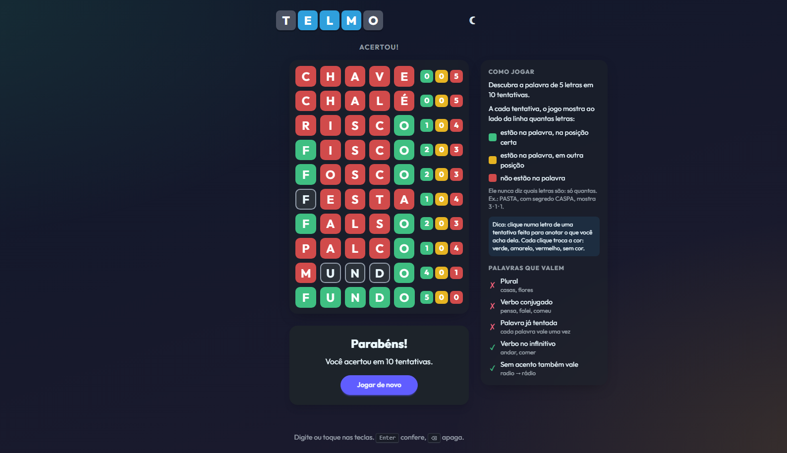

# Telmo

## 1. Identificação

| Nome completo | Matrícula | Turma (14h/16h) | Usuário GitHub |
|---------------|-----------|-----------------|----------------|
| Daniel dos Santos Barros de Sousa        | 211030980  | 14h     | [daniel-de-sousa](https://github.com/daniel-de-sousa)     |
| Henrique Galdino Couto        | 200058258  | 14h           | [hgaldino05](https://github.com/hgaldino05)     |
| João Paulo Monteiro de Barros Ceva Rodrigues       | 202045141  | 14h    | [joaombc](https://github.com/joaombc)     |

- **Nome do projeto:** tELMo
- **Nome do grupo:** tELMo
- **Repositório:** https://github.com/hgaldino05/trabalho-paradigmas-2026-2
- **Commit ou tag entregue:** `v1.0`
- **Ponto de partida:** remix original
- **Slides da apresentação oral:** `docs/apresentacao.pdf`

## 2. Resumo

**t*ELM*o** é um jogo de adivinhar uma palavra de 5 letras em até 10
tentativas. A diferença para o Termo é que o jogo nunca diz quais letras
acertaram, só quantas: ao lado de cada tentativa aparecem três números,
com quantas letras estão na posição certa (verde), quantas estão na
palavra em outra posição (amarelo) e quantas não estão na palavra
(vermelho). Por exemplo, PASTA com o segredo CASPA mostra 3 · 1 · 1, e cabe
ao jogador deduzir quais letras são. Para organizar o raciocínio, ele pode
clicar nas letras das tentativas já feitas e anotar uma cor em cada uma;
essas anotações são só dele, e o jogo não as confere.

O nome junta **Termo** (nome do jogo que serviu de inspiração) e **Elm** (uma das linguagens aprendidas na disciplina). 



## 3. Como executar

**Requisitos** (com as versões que o grupo usou):

- SWI-Prolog 9.2.9
- Node.js 24.15.0 (com npm)
- uv 0.7.4, que instala o Python 3.13.3 sozinho

**Instalação e execução:**

```sh
# terminal 1: backend (http://localhost:8000/docs)
cd backend
uv sync
uv run fastapi dev app/main.py

# terminal 2: frontend (http://localhost:5173)
cd frontend
npm install
npm run dev
```

Com `make` (Linux/macOS), `make install` e depois `make dev` fazem o mesmo.

No Windows há dois cuidados, descritos no `README.md`:

1. o `uv sync` compila o pacote `janus-swi` e precisa do compilador C++ do
   Visual Studio Build Tools; se ele não for encontrado, rode o `uv sync`
   depois do `vcvars64.bat`, com `set DISTUTILS_USE_SDK=1`;
2. antes de subir o backend ou rodar os testes, defina onde está o
   SWI-Prolog: `$env:SWI_HOME_DIR = "C:\Program Files\swipl"` (PowerShell).

**Testes:**

```sh
swipl -g run_tests -t halt backend/prolog/test_jogo.pl    # Prolog (plunit)
cd backend && uv run pytest                                # API (pytest)
cd frontend && npm test                                    # Elm (elm-test)
```

Com `make`, `make test` roda os três conjuntos.

## 4. Arquitetura

```
Navegador (Elm + daisyUI)  --HTTP/JSON-->  FastAPI (Python)  --janus-->  SWI-Prolog
```

Cada partida fica guardada no Prolog, como um fato dinâmico `partida/3`
com a palavra secreta e a situação da partida. O navegador só recebe um
código aleatório (UUID versão 4); a palavra secreta não sai do servidor
antes de a partida ser perdida. O Prolog calcula a cor de cada letra, mas
só devolve a contagem: as cores letra por letra nunca chegam ao navegador.

| Parte  | Responsabilidade | Arquivos principais |
|--------|------------------|---------------------|
| Prolog | Base de palavras, análise de plural e verbo conjugado, cores e contagem de cada tentativa, sorteio e estado de cada partida (palavras já tentadas, fim de jogo) | `backend/prolog/jogo.pl`, `backend/prolog/flexao.pl`, `backend/prolog/palavras.pl`, `backend/prolog/aceitas.pl`, `backend/prolog/lexico.pl` |
| Elm    | Estado da partida, anotações do jogador, teclado físico e virtual, tabuleiro com a contagem, painel de regras, animações e mensagens de erro | `frontend/src/Jogo.elm`, `frontend/src/Api.elm`, `frontend/src/Main.elm`, `frontend/src/style.css`, `frontend/tests/JogoTest.elm` |
| Python | Integração (valida o formato do JSON e chama o Prolog) | `backend/app/main.py`, `backend/app/prolog.py` |

## 5. Parte em Prolog

### 5.1 Predicados principais

| Predicado | Local | O que faz |
|-----------|-------|-----------|
| `retorno(+Tentativa, +Segredo, -Cores)` | `backend/prolog/jogo.pl:63` | Cor de cada letra de uma tentativa, com letras repetidas tratadas em duas passadas |
| `contagem(+Cores, -Contagem)` | `backend/prolog/jogo.pl:100` | Resume as cores em `[Certas, Presentes, Ausentes]`, a única coisa que o jogador fica sabendo |
| `palavra(?Letras, ?Texto)` | `backend/prolog/jogo.pl:118` | Tentativas válidas: as respostas, e as outras palavras do dicionário que não são plural nem verbo conjugado |
| `flexao(?Palavra, ?Base, ?Tipo)` | `backend/prolog/flexao.pl:44` | Analisa uma palavra como plural de um singular ou conjugação de um infinitivo do dicionário; uma solução por análise |
| `plural//1` e `conjugacao//1` | `backend/prolog/flexao.pl:69`, `backend/prolog/flexao.pl:124` | Gramáticas (DCG): a palavra é um radical seguido de uma terminação de plural ou verbal |
| `texto_letras(+Texto, -Letras)` | `backend/prolog/jogo.pl:125` | `"Rádio"` vira `[r,a,d,i,o]`: minúsculas e sem acento |
| `partida(?Id, ?Segredo, ?Situacao)` | `backend/prolog/jogo.pl:166` | Fato dinâmico: uma partida em andamento, com o segredo e `jogando(Tentadas)` (as palavras já tentadas) ou `perdeu` |
| `novo_jogo(-Id)` | `backend/prolog/jogo.pl:186` | Sorteia o segredo e abre uma partida com código aleatório |
| `jogar(+Id, +Texto, -Resultado)` | `backend/prolog/jogo.pl:201` | Contagem da tentativa e atualização da partida; ou `invalida`, `repetida`, `encerrada`, `inexistente` |
| `revelar(+Id, -Resultado)` | `backend/prolog/jogo.pl:242` | A palavra secreta, só depois que a partida foi perdida; senão `negado` |
| `resposta/2`, `aceita/2` e `vocabulo/1` | `backend/prolog/palavras.pl:13`, `backend/prolog/aceitas.pl:19`, `backend/prolog/lexico.pl:20` | Base de conhecimento: 1000 palavras sorteáveis, as 4377 outras palavras de 5 letras do dicionário (954 delas valem como tentativa) e 2941 palavras de outros tamanhos que a análise consulta |

### 5.2 Conceitos do paradigma lógico utilizados

- [x] Fatos e regras como base de conhecimento: as palavras são fatos `resposta/2` (`palavras.pl`) e `aceita/2` (`aceitas.pl`); a tabela de acentos são fatos `acento/2` (`jogo.pl:137`); `palavra/2` é uma regra que une as duas bases (`jogo.pl:118`); `vocabulo/1` (`lexico.pl`) e as terminações verbais e formas irregulares (`terminacoes/2` e `irregulares/2`, `flexao.pl:220` e `flexao.pl:244`) são a base que a análise de palavras consulta.
- [x] Unificação e casamento de padrões: as cláusulas de `colore/5` são escolhidas pela forma da marca, `certa` ou `livre(_)` (`jogo.pl:87`); `letra_livre/2` só casa com `livre(S)` e, dentro de `convlist/3`, descarta as marcas `certa` (`jogo.pl:78`); `avancar/5` escolhe a cláusula pela situação da partida, `perdeu` ou `jogando(Tentadas)` (`jogo.pl:212`); `memberchk/2` recusa uma palavra que já está em `Tentadas` (`jogo.pl:216`); a cabeça `contagem(Cores, [Certas, Presentes, Ausentes])` monta a resposta por unificação (`jogo.pl:100`).
- [x] Recursão (inclusive sobre listas): escrita à mão nas gramáticas de `flexao.pl`, em `radical//1` (`flexao.pl:75`) e `letras//1` (`flexao.pl:136`), com o caso base `[]` e o caso recursivo `[L|Ls]`, que consome uma letra e segue com o resto. É essa recursão que permite dividir uma palavra em radical e terminação de todas as formas possíveis. Nas outras partes, as listas de letras são percorridas pelos predicados de ordem superior abaixo, que são recursivos por dentro.
- [x] Backtracking e múltiplas soluções: `palavra/2` tem duas cláusulas (`jogo.pl:118`); por backtracking, a busca passa das respostas para as aceitas, e `once/1` fica com a primeira solução (`jogo.pl:218`). Em `flexao/3` (`flexao.pl:44`), o backtracking experimenta cada divisão da palavra em radical e terminação, e cada divisão que leva a uma palavra do dicionário é uma solução: `casas` tem duas análises, plural de *casa* e “tu casas”, de *casar*; `falas` tem três. O jogo só precisa saber se existe alguma (`flexionada/1`, com `once/1`), mas as análises completas são o que os testes conferem. Nos testes, `exclude/3` e `append/3` montam as tentativas erradas (`test_jogo.pl`).
- [x] `findall/3`, `bagof/3`, `setof/3` ou similares: `findall/3` em `novo_jogo/1` junta as respostas para o sorteio com `random_member/2` (`jogo.pl:187`); `findall/3` e `forall/2` nos testes da base de palavras e das partidas (`test_jogo.pl`).
- [x] Corte (`!`) ou negação (`\+`), e por que foram necessários: não usamos corte. A negação aparece em `avancar/5`, onde `\+ once(palavra(Tentativa, _))` recusa uma palavra fora da base (`jogo.pl:214`); em `palavra/2`, `\+ flexionada(Letras)` tira plurais e verbos conjugados (`jogo.pl:119`); e em `flexao.pl`, `\+ substantivo_em_o(Palavra)` impede que “livro” vire “eu livro”, porque “livros” existe (`flexao.pl:107`). Usamos if-then-else (`->`) para escolhas determinísticas, como em `marca_verde/3` (`jogo.pl:70`), `colore/5` (`jogo.pl:88`) e `depois_da_jogada/4` (`jogo.pl:228`), e `once/1` em `avancar/5` (`jogo.pl:218`) para não deixar pontos de escolha quando uma palavra é encontrada. Os testes usam `\+` para conferir a base (`test_jogo.pl`).
- [ ] Programação por restrições (CLP(FD) ou outra): não usamos; o problema é de busca numa base finita de palavras, não de domínios numéricos.
- [x] Predicados de ordem superior (`maplist`, `foldl`, `include` etc.): `maplist/4`, `convlist/3` e `foldl/6` em `retorno/3` (`jogo.pl:64`); `include(==(Cor), Cores, DessaCor)`, com aplicação parcial, para contar as letras de cada cor em `quantas/3` (`jogo.pl:106`); `maplist/3` em `texto_letras/2` (`jogo.pl:128`); `maplist(==(certa), Cores)` para saber se o jogador ganhou (`jogo.pl:229`).
- [x] Outro: gramáticas de cláusulas definidas (DCG). Em `flexao.pl`, `plural//1` (`flexao.pl:69`) e `conjugacao//1` (`flexao.pl:124`) descrevem como uma palavra é formada: um radical (`radical//1`, que consome qualquer começo da palavra) seguido de uma terminação. A mesma gramática serve para analisar: `phrase(plural(Singular), [c,a,s,a,s])` encontra `Singular = [c,a,s,a]`. Mudanças de grafia (fiquei, de ficar; fujo, de fugir) são desfeitas por `radical_verbal/4` (`flexao.pl:160`), uma cláusula por regra.
- [x] Outro: indexação de cláusulas. A marca é o primeiro argumento de `colore/5` porque o SWI-Prolog indexa pelo primeiro argumento; com a ordem invertida, um teste plunit avisava que `retorno/3` deixava um ponto de escolha aberto (`jogo.pl:87`).
- [x] Outro: base de conhecimento dinâmica. Cada partida é um fato `partida/3` declarado com `:- dynamic` (`jogo.pl:166`), criado com `assertz/1` e trocado com `retract/1` a cada tentativa; `with_mutex/2` impede que duas requisições mexam na mesma partida ao mesmo tempo (`jogo.pl:204`).

### 5.3 Trecho em destaque

```prolog
retorno(Tentativa, Segredo, Cores) :-
    maplist(marca_verde, Tentativa, Segredo, Marcas),
    convlist(letra_livre, Marcas, Sobra),
    foldl(colore, Marcas, Tentativa, Cores, Sobra, _).

colore(certa, _, certa, Sobra, Sobra).
colore(livre(_), Letra, Cor, Sobra0, Sobra) :-
    (   selectchk(Letra, Sobra0, Sobra)   % tira UMA ocorrência da sobra
    ->  Cor = presente
    ;   Cor = ausente,
        Sobra = Sobra0
    ).

avancar(perdeu, _, _, _, encerrada).
avancar(jogando(Tentadas), Id, Segredo, Tentativa, Resultado) :-
    (   \+ once(palavra(Tentativa, _))
    ->  Resultado = invalida
    ;   memberchk(Tentativa, Tentadas)
    ->  Resultado = repetida
    ;   once(palavra(Tentativa, Exibicao)),
        retorno(Tentativa, Segredo, Cores),
        retract(partida(Id, Segredo, _)),
        depois_da_jogada(Cores, [Tentativa | Tentadas], Id, Segredo),
        contagem(Cores, Contagem),
        Resultado = [Exibicao, Contagem]
    ).
```

`retorno/3` (`jogo.pl:63`) resolve o caso difícil do jogo: letras
repetidas. Com o segredo `termo` e a tentativa `terra`, só o primeiro r
conta como certo; o segundo é ausente, porque `termo` tem um r só. O
predicado declara isso em duas passadas: `maplist/4` marca cada posição
como `certa` ou `livre(S)`; `convlist/3` junta as letras do segredo que
sobraram; e `foldl/6` percorre a tentativa carregando essa sobra, e cada
amarela consome uma letra dela com `selectchk/3`. Isso importa mesmo sem
mostrar as cores: a contagem de `terra` contra `termo` precisa dar
3 · 0 · 2, e não 3 · 1 · 1.

`avancar/5` (`jogo.pl:212`) guarda o estado de uma partida como fato. A
situação `jogando(Tentadas)` ou `perdeu` escolhe a cláusula por
unificação: uma partida perdida responde `encerrada` sem olhar a
tentativa. Uma palavra fora da base é `invalida`, e uma que já está em
`Tentadas` é `repetida`; nenhuma das duas gasta tentativa. Numa tentativa
válida, o fato antigo sai com `retract/1` e `depois_da_jogada/4` grava o
novo: nenhum, se o jogador ganhou; `perdeu`, se esgotou as 10 tentativas;
ou `jogando` com a palavra nova na lista. Só no fim `contagem/2` resume as
cores em três números, e é só isso que volta para o Python. Como o segredo fica no fato, e
não é deduzido de um número, o navegador não tem como descobri-lo, e mudar
a ordem de `palavras.pl` não muda a palavra de nenhuma partida.

```prolog
flexao(Palavra, Singular, plural) :-
    phrase(plural(Singular), Palavra),
    lexema(Singular).

plural(Singular) --> radical(Radical), terminacao_plural(Radical, Singular).

radical([]) --> [].
radical([L|Ls]) --> [L], radical(Ls).

terminacao_plural(R, R) --> [s].                                     % casas -> casa
terminacao_plural(R, S) --> [n, s], { append(R, [m], S) }.           % trens -> trem
```

`flexao/3` (`flexao.pl:44`) decide se uma palavra é plural ou verbo
conjugado, que não valem como tentativa. O dicionário não diz a classe das
palavras, então a regra é escrita como uma gramática (DCG): uma palavra é
plural se ela se divide num radical seguido de uma terminação de plural, e
o singular recomposto existe no dicionário. `radical//1` consome qualquer
começo da palavra, e o backtracking experimenta cada divisão; cada uma que
leva a uma palavra existente é uma solução. Por isso `casas` tem duas
análises (plural de *casa* e “tu casas”, de *casar*), e o jogo só pergunta
se existe alguma (`flexionada/1`). A mesma ideia vale para os verbos
(`conjugacao//1`, `flexao.pl:124`): radical de um infinitivo do dicionário
mais uma terminação verbal, desfazendo as mudanças de grafia como fiquei,
de ficar. Antes essa regra estava num script Python que filtrava a lista
uma vez; em Prolog ela virou uma descrição de como as palavras se formam,
que aceita exatamente as mesmas 954 palavras.

## 6. Parte em Elm

### 6.1 Modelo e mensagens

```elm
-- Jogo.elm (domínio puro)
type alias Contagem = { certas : Int, presentes : Int, ausentes : Int }

type Marca = Verde | Amarela | Vermelha   -- anotação do jogador numa letra

type alias Tentativa =
    { digitada : String
    , exibida : String
    , contagem : Contagem
    , marcas : List (Maybe Marca)   -- uma por letra; Nothing = sem cor
    }

type Estado
    = Digitando String       -- o jogador está escrevendo a próxima palavra
    | Conferindo String      -- a palavra foi enviada; esperamos o servidor
    | Venceu
    | Perdeu (Maybe String)  -- o segredo chega depois, pelo servidor

type alias Jogo = { id : String, tentativas : List Tentativa, estado : Estado }

-- Api.elm
type Erro = Recusada String | Falha String

-- Main.elm
type Tela = Iniciando | EmJogo Jogo | SemServidor String

type alias Model =
    { tela : Tela
    , toast : Maybe Toast
    , proximoToast : Int
    , aviso : Maybe String
    , darkTheme : Bool
    }

type Msg
    = NovoJogoPedido
    | NovoJogoRecebido (Result Api.Erro String)
    | LetraDigitada Char
    | Apagou
    | Enviou
    | RetornoRecebido (Result Api.Erro Retorno)
    | SegredoRecebido (Result Api.Erro String)
    | ToastFechado
    | ToastExpirou Int
    | ToastRemovido Int
    | AvisoFechado
    | TemaTrocado Bool
    | MarcaAlternada Int Int   -- clique na letra (tentativa, posição)
```

- **`Estado`** (`Jogo.elm:111`) troca vários `Bool` (`venceu`, `perdeu`,
  `esperando`) por um único custom type. Não existe o estado "venceu e
  perdeu" nem "digitando enquanto espera o servidor": em `Conferindo`, as
  funções `digitar` e `apagar` simplesmente não fazem nada.
- **`Perdeu (Maybe String)`**: quando acabam as tentativas, a palavra
  secreta ainda não chegou do servidor. O `Maybe` deixa explícito esse
  intervalo, e a tela mostra “Buscando a palavra” até ele virar `Just`.
- **`Contagem`** (`Jogo.elm:49`): o servidor manda só três números por
  tentativa, então não existe no Elm um tipo de cor por letra. O navegador
  nem recebe essa informação, e o jogador não tem como descobri-la pelas
  ferramentas do navegador.
- **`Marca`** (`Jogo.elm:85`): a anotação do jogador é `Maybe Marca`, uma
  por letra. `Nothing` é "sem cor", e cada clique passa para a próxima da
  ordem verde, amarela, vermelha, sem cor (`proximaMarca`). As marcas
  ficam na `Tentativa`, mas nunca vão para o servidor.
- **`Tela`** (`Main.elm:52`): enquanto o servidor não sorteia a palavra não
  existe `Jogo`, em vez de um `Jogo` com `id` falso.
- **`Erro`** (`Api.elm:35`): o servidor responde 422 quando a palavra não
  está na lista ou já foi tentada. Com `Recusada` e `Falha`, o `update` decide pela forma do
  valor se mostra o toast vermelho de palavra desconhecida ou a faixa de
  erro de rede, em vez de comparar o texto da mensagem.
- **`Toast`** (`Main.elm:70`) tem um `id`, um motivo (`ForaDaLista` ou
  `JaTentada`) e uma fase (`Visivel` ou `Saindo`). O `id` faz o aviso
  atrasado de um toast antigo ser ignorado quando já há outro na tela; o
  motivo decide o texto do aviso, e o `case` obriga a tratar os dois.

### 6.2 Conceitos do paradigma funcional utilizados

- [x] Arquitetura Elm (Model, update, view): `Main.elm` (`update` em `Main.elm:147`), com `Jogo.elm` como domínio puro, sem HTTP nem HTML.
- [x] Custom types e `case` exaustivo: `Estado`, `Marca` (`Jogo.elm:85`), `Erro`, `Tela`, `Motivo` (`Main.elm:80`), `FaseDoToast`; `proximaMarca` (`Jogo.elm:276`) e `classeDaMarca` (`Main.elm:615`) tratam todos os casos de `Maybe Marca`; o `update` casa padrões em pares, como `( RetornoRecebido (Err (Api.Recusada _)), EmJogo jogo )`.
- [x] `Maybe` e `Result` no lugar de null e exceções: `conferir : Jogo -> Maybe ( Jogo, String )` (`Jogo.elm:164`), `Perdeu (Maybe String)`, `Maybe Toast`, `List (Maybe Marca)`; todas as respostas HTTP chegam como `Result Api.Erro a`.
- [x] Funções de ordem superior e aplicação parcial: em `alternarMarca` (`Jogo.elm:254`), a função local `naPosicao` recebe a transformação como argumento e é usada duas vezes, uma dentro da outra (na tentativa e na letra), com `naPosicao posicao proximaMarca` aplicada parcialmente; `List.any` em `jaTentada` (`Jogo.elm:221`); `List.indexedMap` e `List.map2 Tuple.pair` no tabuleiro.
- [x] Composição (`|>`, `>>`): `Process.sleep duracaoDoToast |> Task.perform …` (`Main.elm:288`) e o pipeline `|> Result.mapError` em `expectJson` (`Api.elm:123`).
- [x] Decoders e encoders JSON: `retornoDecoder` (`Api.elm:91`) e `contagemDecoder` (`Api.elm:100`), que monta a `Contagem` com `Decode.map3`; `expectJson` próprio lê o corpo das respostas de erro (`Api.elm:116`).
- [x] Comandos e subscriptions (efeitos controlados): `Browser.Events.onKeyDown` com um decoder que falha para teclas ignoradas (`Main.elm:308`); `Process.sleep` vira comando para o toast sumir sozinho (`Main.elm:288`).
- [x] Imutabilidade e atualização de records: `{ jogo | tentativas = tentativas, estado = estado }` em `registrar` (`Jogo.elm:209`); `{ tentativa | marcas = … }` em `alternarMarca`.
- [x] Outro: testes do domínio puro. Como `Jogo.elm` não faz HTTP nem HTML, os testes elm-test (`frontend/tests/JogoTest.elm`) jogam partidas inteiras sem navegador e sem servidor, com funções puras que fazem o papel do jogador e do servidor (`jogar`, `jogarTodas`).
- [x] Outro: `Html.Keyed` no tabuleiro (`Main.elm:515`), para a linha atual ser recriada a cada palavra recusada e a animação de tremer tocar de novo.
- [x] Reaproveitamento de mensagens: o teclado virtual (`viewTeclado`, `Main.elm:703`) não cria mensagens novas. Cada tecla dispara as mesmas `LetraDigitada`, `Enviou` e `Apagou` do teclado físico. As teclas não têm cor, de propósito: colorir uma tecla diria se a letra está na palavra. Elas usam `preventDefaultOn "mousedown"` (`Main.elm:711`) para não ganhar foco: senão, um Enter do teclado físico apertaria de novo a última tecla clicada.

### 6.3 Trecho em destaque

```elm
registrar : Retorno -> Jogo -> Jogo
registrar retorno jogo =
    case jogo.estado of
        Conferindo digitada ->
            let
                tentativas =
                    jogo.tentativas
                        ++ [ { digitada = digitada
                             , exibida = retorno.palavra
                             , contagem = retorno.contagem
                             , marcas = List.repeat tamanhoPalavra Nothing
                             }
                           ]

                estado =
                    if acertou retorno.contagem then
                        Venceu

                    else if List.length tentativas >= maxTentativas then
                        Perdeu Nothing

                    else
                        Digitando ""
            in
            { jogo | tentativas = tentativas, estado = estado }

        _ ->
            jogo
```

`registrar` (`Jogo.elm:185`) recebe o retorno do servidor e decide o que
acontece com a partida. Ele só age em `Conferindo`: a palavra digitada que
está guardada nesse construtor é a mesma que foi enviada, então não há como
registrar o retorno de uma palavra contra outra. Uma resposta que chega
fora de hora (por exemplo, depois de o jogador começar um jogo novo) cai no
`_ -> jogo` e é ignorada. O próximo estado é calculado de forma pura, a
partir da contagem: 5 letras certas é vitória (`acertou`,
`Jogo.elm:93`); esgotar as 10 tentativas é
`Perdeu Nothing`, e o `update` então pede o segredo ao servidor; senão, o
jogador volta a `Digitando ""`. A tentativa nova entra sem nenhuma
anotação (`List.repeat tamanhoPalavra Nothing`), pronta para o jogador
marcar.

## 7. Integração

| Rota / chamada | Entrada | Saída | Predicado Prolog |
|----------------|---------|-------|------------------|
| `POST /api/novo` | nada | `{"jogo": "5cf75573-…"}` | `novo_jogo/1` |
| `POST /api/tentativa` | `{"jogo": "5cf75573-…", "palavra": "radio"}` | `{"palavra": "rádio", "contagem": {"certas": 1, "presentes": 2, "ausentes": 2}}`; 422 (fora da lista ou já tentada), 409 (partida já perdida) ou 404 (partida inexistente) | `jogar/3` |
| `POST /api/revelar` | `{"jogo": "5cf75573-…"}` | `{"palavra": "termo"}` só depois da derrota; 403 antes disso, 404 se não existe | `revelar/2` |

As rotas estão em `backend/app/main.py:67` e a ponte com o janus em
`backend/app/prolog.py`. O janus não converte termos compostos, por isso
os predicados de interface devolvem uma lista quando dá certo e um átomo
nos casos de erro (`invalida`, `repetida`, `encerrada`, `inexistente`,
`negado`), que o
Python traduz para exceções e depois para códigos HTTP. A contagem chega
como a lista `[Certas, Presentes, Ausentes]`, e o modelo `Contagem` do
FastAPI dá nome aos três números e confere que cada um está entre 0 e 5.

## 8. Testes e validação

- **Testes plunit** (`backend/prolog/test_jogo.pl`, 32 testes): cores e
  contagem de uma tentativa, formato da base de palavras, a análise de
  plural e verbo conjugado (inclusive as várias análises de uma mesma
  palavra) e o ciclo de vida das partidas (criar, jogar, ganhar, perder em
  10 tentativas, revelar).
- **Testes pytest** (`backend/tests/test_api.py`, 12 testes): rotas,
  formato do JSON (a resposta só tem a contagem, nunca as cores) e códigos
  de status.
- **Testes elm-test** (`frontend/tests/JogoTest.elm`, 29 testes):
  partidas completas jogadas no domínio do Elm, sem navegador e sem
  servidor. Como `Jogo.elm` é puro, o teste faz o papel do jogador
  (digitar, apagar, conferir) e do servidor (responder com uma contagem):
  vitória, derrota em 10 tentativas, digitação, palavra recusada, resposta
  fora de hora e anotações.
- **Partidas jogadas à mão** no navegador, para conferir a tela e as
  animações, que os testes automáticos não cobrem.
- **Casos de borda considerados:**
  - letra repetida na tentativa e não no segredo (`terra` contra `termo`);
  - letra repetida no segredo (`arroz` contra `carro`);
  - amarela que gasta a letra (`ossos` contra `termo`: só um 'o' amarelo);
  - verde com prioridade sobre amarela (`ooooo` contra `termo`);
  - a contagem do exemplo do painel de regras (`pasta` contra `caspa`:
    3 · 1 · 1) e com letra repetida (`terra` contra `termo`: 3 · 0 · 2);
  - a resposta da API não traz as cores letra por letra;
  - pedir a palavra no meio da partida (`revelar/2` responde `negado`, e a
    API, 403);
  - tentativa depois da derrota (409), partida inexistente ou já ganha
    (404) e palavra revelada uma vez só (depois disso, a partida some);
  - palavra fora da lista não gasta tentativa;
  - palavra repetida na mesma partida é recusada, também com outro
    acento (`radio` e depois `rádio`), e não gasta tentativa; o Elm
    confere antes de enviar, e o Prolog confere de novo;
  - código da partida chegando do Python como string (o fato guarda um
    átomo);
  - palavra fora da lista (422 e toast vermelho) e palavra com tamanho
    errado;
  - acentos e maiúsculas (`"Rádio"` vira `[r,a,d,i,o]`, e `radio` volta como
    `rádio`);
  - plurais e verbos conjugados são recusados (`casas`, `falei`), mas verbos no
    infinitivo são aceitos (`andar`, `latir`);
  - plural com terminação própria (`luzes`, `trens`, `azuis`, `leões`),
    verbo com mudança de grafia (`fujam`, de fugir; `caiam`, de cair) e
    verbo irregular (`posso`);
  - palavra com mais de uma análise (`casas`: plural de casa e verbo
    casar);
  - substantivo em -o que parece verbo (`livro`) e resposta que também é
    forma verbal (`conta`, que vale porque está em `palavras.pl`);
  - a análise em Prolog aceita exatamente as mesmas 954 palavras que o
    filtro antigo, escrito em Python, aceitava (conferido palavra por
    palavra ao trocar o filtro);
  - nenhuma combinação de letras repetida na base (por exemplo, `força` e
    `forca` juntas);
  - Enter com menos de 5 letras, letras além da quinta, números e símbolos
    (ignorados), teclas com Ctrl ou Cmd (ignoradas para não atrapalhar
    atalhos do navegador) e resposta do servidor que chega depois de um
    jogo novo (ignorada por `registrar`);
  - clique numa tecla do teclado virtual seguido de Enter no teclado
    físico (a tecla não ganha foco, então a letra não se repete);
  - anotações do jogador: cada clique numa letra passa pela ordem verde,
    amarelo, vermelho, sem cor, e só muda aquela letra; a linha vencedora
    não aceita anotação.

## 9. Limitações e problemas conhecidos

- As partidas ficam na memória do servidor. Reiniciar o backend apaga as
  partidas abertas: o jogador vê "Partida não encontrada" e precisa começar
  outra.
- Uma partida abandonada no meio nunca é apagada. Com poucos jogadores
  isso não pesa, mas num servidor público seria preciso expirar partidas
  antigas.
- O número de tentativas (10) aparece em dois lugares: `max_tentativas/1`
  no Prolog e `maxTentativas` no Elm. Mudar um exige mudar o outro.
- As anotações do jogador ficam só na memória do navegador: recarregar a
  página perde a partida e as anotações.
- As 1000 respostas foram escritas com ajuda de IA e ainda precisam de
  revisão do grupo. 27 delas não aparecem no dicionário usado para as
  tentativas aceitas, que é de 2003 e incompleto. Elas continuam valendo,
  porque as respostas são uma lista à parte.
- Plural e verbo conjugado não valem, mas o dicionário não diz a classe
  de cada palavra: a análise de `flexao.pl` usa regras de formação e é
  aproximada. Escapam algumas formas irregulares (`sinta`), e alguns
  substantivos que coincidem com verbos ficaram de fora (`baixa`, `ginga`).
- `aceitas.pl` (cerca de 4400 linhas) e `lexico.pl` (cerca de 3000) são
  dados extraídos do dicionário por script. Eles aumentam a proporção de
  linhas em Prolog nas métricas sem ser lógica escrita pelo grupo; a
  lógica sobre essas palavras está em `flexao.pl`.
- No Windows, o backend exige compilar o `janus-swi` e definir
  `SWI_HOME_DIR` (seção 3).

## 10. Contribuição de cada integrante

| Integrante | Principais contribuições |
|------------|--------------------------|
| Daniel dos Santos Barros de Sousa      | Lógica das palavras e integração: análise de plural e verbo conjugado (`flexao.pl`), base de palavras (busca do dicionário e geração de `aceitas.pl` e `lexico.pl` com `gerar_aceitas.py`), ponte entre Python e Prolog (`prolog.py`), rotas da API (`main.py`) e testes da API (`test_api.py`); documentação (README, relatório e slides) |
| Henrique Galdino Couto     | Interface em Elm: tipos e estados da partida (`Jogo.elm`), comunicação com o backend (`Api.elm`), tela, contagem e anotações do jogador (`Main.elm`, `style.css`) e testes elm-test (`JogoTest.elm`); documentação (README, relatório e slides) |
| João Paulo Monteiro de Barros Ceva Rodrigues       | Núcleo do jogo em Prolog: cores e contagem de cada tentativa (`retorno/3`, `contagem/2`), validação das tentativas e estado das partidas (`partida/3`, `jogar/3`, `revelar/2`) e testes plunit (`test_jogo.pl`); documentação (README, relatório e slides) |

Cada integrante revisou e responde pela sua parte do código. O uso de
ferramentas de IA na produção do código e da documentação está declarado
na seção 11.


## 11. Fontes, código de terceiros e uso de IA

**Código reaproveitado.** Partimos do projeto-modelo do Sudoku
(https://github.com/fabiommendes/paradigmas-trabalho-final). Mantivemos a
infraestrutura: `Makefile`, `vite.config.js`, `package.json`, `index.html`,
`main.js`, a integração Python com o janus, a função `expectJson` de
`Api.elm`, o botão de tema de `Main.elm` e os scripts de `scripts/`. No
`Makefile` e no `package.json`, acrescentamos os testes do Elm. Todas as
regras foram trocadas: `jogo.pl`, `flexao.pl`, `palavras.pl`,
`test_jogo.pl`, `gerar_aceitas.py`, `test_api.py`, `Jogo.elm`,
`JogoTest.elm` e o resto de `Api.elm`, `Main.elm`, `main.py`, `prolog.py`
e `style.css` são deste projeto. `aceitas.pl` e `lexico.pl` são dados
gerados a partir do dicionário citado abaixo.

**Referências.**

- Lista de todas as palavras do português brasileiro, de Paulo Feofiloff
  (IME-USP), preparada a partir do Dicionário br.ispell de Ricardo Ueda
  Karpischek, licença Creative Commons BY 4.0:
  https://www.ime.usp.br/~pf/dicios/. Origem de `backend/prolog/aceitas.pl`
  e `backend/prolog/lexico.pl`, gerados por `backend/tools/gerar_aceitas.py`.
- Documentação do SWI-Prolog (bibliotecas `apply`, `lists`, `random`,
  `uuid`, `plunit` e janus): https://www.swi-prolog.org/pldoc/
- Documentação do Elm e dos pacotes `elm/browser`, `elm/http`, `elm/json`
  e `elm-explorations/test`: https://package.elm-lang.org/
- Documentação do Tailwind CSS e do daisyUI.
- A mecânica do jogo vem do Wordle e de sua versão em português, o Termo.
  Nenhum código, lista de palavras ou elemento visual desses jogos foi
  usado.

**Uso de ferramentas de IA.**

- **Faixa de uso no código:** intensivo

A maior parte do código foi escrita pelo Claude, a partir das instruções do
grupo sobre as regras do jogo e como os paradigmas poderiam ser utilizados no desenvolvimento do mesmo. 

| Ferramenta | Para que foi usada | Como o grupo verificou o resultado |
|------------|--------------------|------------------------------------|
| Claude (Claude Code) | Código do jogo, a partir das regras do grupo e indicações do grupo: Prolog (`jogo.pl`, `flexao.pl`), Python (`prolog.py`, `main.py`, `gerar_aceitas.py`) e Elm (`Jogo.elm`, `Api.elm`, `Main.elm`, `style.css`), incluindo a lógica e a interface | Revisão de cada parte pelo integrante responsável (seção 10); testes automatizados; partidas jogadas no navegador; correções pedidas pelo grupo |
| Claude (Claude Code) | Testes automatizados: `test_jogo.pl` (plunit), `test_api.py` (pytest) e `JogoTest.elm` (elm-test) | Execução dos 73 testes; um teste de mutação (mudar o número de tentativas de propósito) para conferir que os testes do Elm pegam erros |
| Claude (Claude Code) | Dados: as 1000 respostas de `palavras.pl` | Testes de formato da base (tamanho, acentos, nenhuma repetição) |
| Claude (Claude Code) | Atualizações na documentação (README e RELATORIO.md) e confecção dos slides da apresentação | Leitura, edição e conferência pelo grupo; validador da entrega (`scripts/validar_entrega.py`) |

## 12. Apresentação oral

- **Slides:** `docs/apresentacao.pdf`
- **Roteiro:**

| Parte | Duração | Quem apresenta |
|-------|:-------:|----------------|
| Contexto e objetivo | 2 min | Daniel dos Santos Barros de Sousa |
| Demonstração | 5 min | Henrique Galdino Couto e João Paulo Monteiro de Barros Ceva Rodrigues |
| Código Prolog: cores, contagem e partidas | 2 min | João Paulo Monteiro de Barros Ceva Rodrigues |
| Código Prolog: análise de plural e verbo (gramática) | 1 min | Daniel dos Santos Barros de Sousa |
| Código Elm | 3 min | Henrique Galdino Couto |
| Limitações e aprendizados | 2 min | João Paulo Monteiro de Barros Ceva Rodrigues |

## 13. Reflexão sobre os paradigmas

*Paradigma lógico*: As consultas e buscas foram mais simples de desenvolver do que em linguagens imperativass. As palavras são fatos, "é uma tentativa válida?" é uma regra de duas cláusulas, e a análise de plural e verbo virou uma gramática, bastando descrever "radical + terminação". O backtracking experimenta sozinho todas as divisões da palavra, o que normalmente exigiria laços e controle manual em uma linguagem imperativa. O mais difícil foi pensar sem variáveis que mudam. As letras repetidas exigiram calcular as cores em duas passadas, carregando a "sobra" do segredo com foldl, e um aviso do plunit sobre ponto de escolha só foi resolvido quando entendemos que o SWI-Prolog indexa as cláusulas pelo primeiro argumento.

*Paradigma Funcional*: O compilador impediu principalmente esquecimentos. Quando trocamos as cores por letra pela contagem, o tipo Cor sumiu, e o compilador apontou cada lugar que ainda o usava; só compilou quando a mudança estava completa. O tipo Estado tornou impossível escrever situações como "venceu e perdeu", e a ausência de null obrigou a tratar o momento em que a palavra secreta ainda não chegou.

Tanto no backend quanto no frontend, a lógica fica separada dos efeitos: o Prolog guarda o estado como fatos e confia na busca, e o Elm obriga toda mudança a passar pelo update.

---

